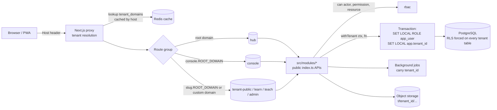

# Architecture

A modular monolith: one Next.js App Router codebase, one PostgreSQL database with a shared schema, and strict tenant isolation. See `docs/MASTER_PROMPT.md` Sections 2, 3 and 13 for the requirements.

## Request flow

## Layers (enforced by ESLint)

| Layer               | May import                                         |
| ------------------- | -------------------------------------------------- |
| `src/app`           | modules, design-system, lib, i18n (never `src/db`) |
| `src/modules/*`     | other modules via `index.ts`, db, lib, i18n        |
| `src/design-system` | design-system, lib, i18n                           |
| `src/db`            | db, lib                                            |
| `src/lib`           | lib                                                |

## Isolation layers

1. Host-based tenant resolution in the proxy (P2).
2. A data-access layer that cannot run a query without a `TenantContext` (`withTenant`, P2).
3. Postgres RLS with `FORCE ROW LEVEL SECURITY`, under a role without BYPASSRLS (roles created in `0000_foundation.sql`).

_Status: P0 skeleton. Sections are filled in as packages land._
