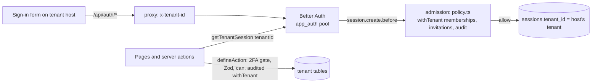

# Architecture

A modular monolith: one Next.js App Router codebase, one PostgreSQL database with a shared schema, and strict tenant isolation. See `docs/MASTER_PROMPT.md` Sections 2, 3 and 13 for the requirements.

## Request flow

```mermaid
flowchart LR
  B[Browser / PWA] -->|Host header| P[src/proxy.ts<br/>decideRoute]
  P -->|classifyHost: hub, console, slug, custom domain| R{Surface}
  P -.->|resolve_tenant_by_slug / _by_host<br/>SECURITY DEFINER, app_resolver<br/>30 s in-process cache| D
  R -->|root domain| H[(hub) pages<br/>/, /partners, /sign-in, /design/demo]
  R -->|active tenant: /x rewritten to /t/slug/x| T[t/tenant layout<br/>branded shell]
  R -->|unknown, inactive, console, bad host| N[404 before rendering]
  T -->|getTenantShell: use cache<br/>tags tenant:id, tenant:id:theme| M[src/modules/*<br/>public index.ts APIs]
  H --> M
  M -->|withTenant ctx, fn| W[Transaction:<br/>SET LOCAL ROLE app_user<br/>set_config app.tenant_id]
  W --> D[(PostgreSQL<br/>RLS forced on every tenant table)]
  M --> J[Background jobs<br/>carry tenant_id]
  M --> S[(Object storage<br/>t/tenant_id/...)]
```

- **Hosts.** `ROOT_DOMAIN` (any port) is the Hub; `console.ROOT_DOMAIN` is the Super Admin Console (P11; 404 until then). `{slug}.ROOT_DOMAIN` (one label) or a verified custom domain is a tenant. Anything else is a 404.
- **Tenant routes** live under `src/app/t/[tenant]`. Browsers never see `/t/...` on a tenant host. On the hub host it works only as the preview path fallback (`APP_ENV` development or preview).
- **Refusals** are rewritten to a path with no route, so Next answers with its not-found page and HTTP 404 before anything streams.
- **Caching.** The tenant shell (name, logo, settings, flags, theme CSS) is cached by tenant id and tagged `tenant:<id>` and `tenant:<id>:theme`. Only the slug → id lookup is cached by slug, for minutes, and tagged `tenant-slug:<slug>`. The partner directory is tagged `partners`.

## Data model (P2)

| Table             | Scope                                                           | RLS                                         | app_user                                                                |
| ----------------- | --------------------------------------------------------------- | ------------------------------------------- | ----------------------------------------------------------------------- |
| `plans`           | global                                                          | none                                        | select                                                                  |
| `tenants`         | tenant root                                                     | `id = app.tenant_id`                        | select                                                                  |
| `tenant_domains`  | tenant; `unique (tenant_id, host)`, one verified owner per host | tenant_id                                   | select, delete; insert and update of some columns (never `verified_at`) |
| `tenant_themes`   | tenant                                                          | tenant_id                                   | all                                                                     |
| `tenant_settings` | tenant (one row)                                                | tenant_id; composite FK to its active theme | all                                                                     |
| `feature_flags`   | tenant                                                          | tenant_id                                   | select                                                                  |

| `memberships` | tenant | tenant_id | all; a user's role in one tenant |
| `invitations` | tenant | tenant_id | all; hashed single-use tokens |
| `audit_logs` | tenant | tenant_id | insert and select only; append-only trigger |
| `users` and identity tables | global (ADR 0004) | `app_auth` only; `users` readable by `app_user` for current-tenant members | none, except those `users` columns |

Every tenant table is registered in `tests/integration/tenant-tables.ts`, and the isolation suite runs the 7 checks of `.claude/rules/db.md` on each. New tables follow the `add-tenant-table` skill.

## Layers (enforced by ESLint)

| Layer               | May import                                         |
| ------------------- | -------------------------------------------------- |
| `src/app`           | modules, design-system, lib, i18n (never `src/db`) |
| `src/modules/*`     | other modules via `index.ts`, db, lib, i18n        |
| `src/design-system` | design-system, lib, i18n                           |
| `src/db`            | db, lib                                            |
| `src/lib`           | lib                                                |

## Database roles

| Role                         | Login | Used by                                     | Can do                                                        |
| ---------------------------- | ----- | ------------------------------------------- | ------------------------------------------------------------- |
| owner (`DATABASE_OWNER_URL`) | yes   | `scripts/db-*.ts`, tests                    | owns every object; runs migrations                            |
| `app_login` (`DATABASE_URL`) | yes   | the app                                     | nothing on its own; may `set role` to the two below           |
| `app_user`                   | no    | `withTenant`                                | table grants; subject to forced RLS on `app.tenant_id`        |
| `app_platform`               | no    | audited Super Admin paths (P11)             | explicit platform policies; no BYPASSRLS                      |
| `app_resolver`               | no    | owns the pre-tenant lookup functions        | a few columns of `tenants` and `tenant_domains`; no BYPASSRLS |
| `app_auth`                   | no    | Better Auth's pool (src/modules/auth/db.ts) | identity tables only, a few `tenants` columns; no BYPASSRLS   |

## Isolation layers

1. Host-based tenant resolution in the proxy (`src/proxy.ts`, logic in `src/modules/tenancy/routing.ts`).
2. A data-access layer that cannot run a query without a `TenantContext` (`withTenant` in `src/modules/tenancy/with-tenant.ts`).
3. Postgres RLS with `FORCE ROW LEVEL SECURITY`, under a role without BYPASSRLS (roles created in `0000_foundation.sql`).

## Authentication (P3)



_Status: through P3. Sections are filled in as packages land._
